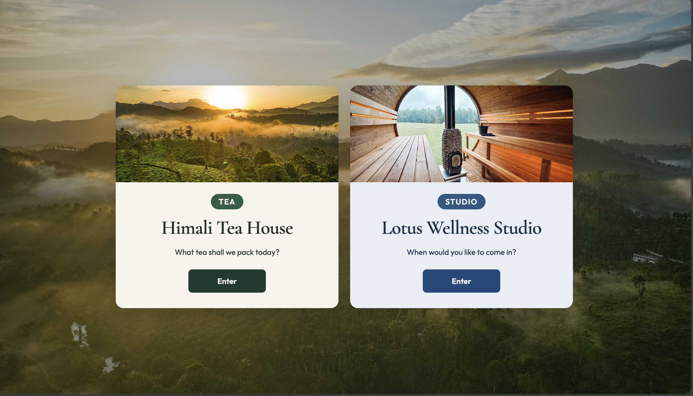
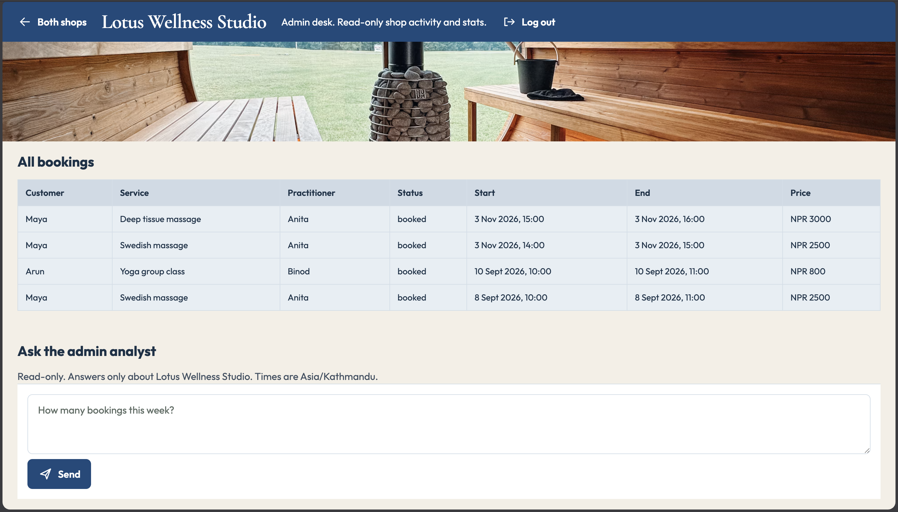
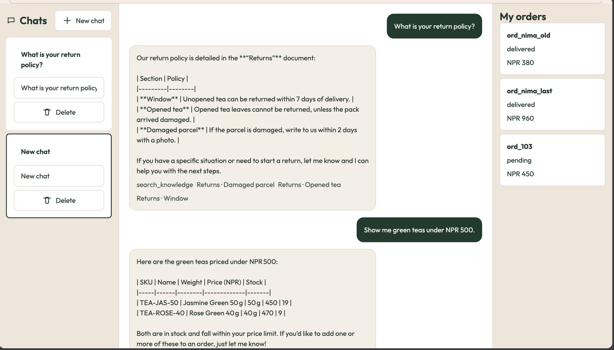

# multi-tenant-chat-agents

Himali Tea House (org_a, tea) takes tea orders. Lotus Wellness Studio (org_b, studio) books massage, physio, and yoga. The shops do not share rows. Prices are NPR. Studio times use Asia/Kathmandu.

The first prototype is `n8n-prototype.json`. The app to review is `shop/` and `web/`.



## Setup

Postgres is on port 5433.

```
docker compose up -d
cp .env.example .env
python -m venv .venv
source .venv/bin/activate
pip install -r requirements.txt
make seed
make api
```

In another terminal, start the page:

```
cd web
npm install && npm run dev
```

The API is http://127.0.0.1:8000. The page is http://127.0.0.1:5173.
Put your own keys in `.env`. Chat needs `GROQ_API_KEY`. Embeddings use `GEMINI_API_KEY` when set.
LangSmith tracing turns on when `LANGSMITH_API_KEY` is set (`LANGSMITH_TRACING=true`, project `LANGSMITH_PROJECT`).

Run tests and eval with:

```
make test
make eval
```

`make eval` is the same as `python -m eval.run_eval`. It uses a fake tool planner and checks Postgres after each case. It does not call Groq.

## How a request runs

1. User opens `/shops/himali-tea` or `/shops/lotus-studio`.
2. Login or signup creates a session for that shop only.
3. The page streams chat with `POST /shops/{slug}/chat/stream` and `Authorization: Bearer <token>` (JSON `POST /shops/{slug}/chat` still works).
4. If the token shop does not match the URL shop, the API returns 403.
5. LangGraph builds a ReAct agent for that shop with that shop's tools only.
6. Tools run rules in `shop/rules.py` and read or write Postgres. Writes need a yes (`confirm`).

There is no webhook in the running app. The n8n file was the early prototype.

## Memory and streaming

Each side-list chat is a thread (`conversationId` / `threadId`).
Postgres stores every user and assistant message for that thread, so chats survive API restarts and crashes.
When a new message runs, the API loads the last 12 turns from that thread as short-term context for the agent.
The page reads Server-Sent Events (`token`, `tool`, `citation`, `done`) so the reply appears as it is generated.

## Test logins

Dev password: `devpass`

- bishal@tea.com / `devpass` (customer, tea chat)
- admin@tea.com / `devpass` (admin, tea orders table + admin analyst)
- bishal@studio.com / `devpass` (customer, studio chat)
- admin@studio.com / `devpass` (admin, studio bookings table + admin analyst)

Admins cannot use the customer chat (403). They see a table of that shop’s orders or bookings, and a read-only admin analyst under it (see below).
Signup on the tea URL saves org_a. Signup on the studio URL saves org_b. Signup creates a customer, not an admin. The database stores a bcrypt hash, not the plain password.

Advance a tea order status (admin only):

```
make advance ORDER=ord_nima_last STATUS=confirmed
```

Or `POST /shops/himali-tea/orders/{orderId}/status` with `{"status":"shipped"}` and an admin Bearer token.

## How the shops stay apart

The shop comes from the URL. `/shops/himali-tea/chat` is tea. `/shops/lotus-studio/chat` is studio.
A tea token on the studio chat route gets 403. The page also keeps a tea login on the tea screen.
A shop id in the body or in a header does not change the session. The session row wins.
The database reads orders, bookings, and chats with that session's shop and user. A tea token on `GET /me/bookings` gets 403, so no studio rows come back.

## Admin agent

Each shop has one read-only admin analyst. It lives under the admin table on the page.


The route is `POST /shops/{slug}/admin/chat/stream` with an admin Bearer token. It streams the same SSE events as customer chat (`meta`, `token`, `tool`, `done`, `error`).

Logins:

- admin@tea.com / `devpass` on `/tea`
- admin@studio.com / `devpass` on `/studio`

Example questions:

- Tea: "How many orders today?", "Top 3 teas this week?", "Which teas are low on stock?", "Conversion last 7 days?"
- Studio: "How many bookings this week?", "Practitioner utilisation today?", "Busiest hours all time?", "How many cancellations this week?"

Tools:

- Tea: `order_stats`, `top_products`, `client_stats`, `conversion`
- Studio: `booking_stats`, `top_services`, `client_stats`, `conversion`

How read-only is enforced:

- The SQL lives in `shop/admin_stats.py`. It only runs `SELECT`. A test checks the file has no `INSERT`, `UPDATE`, `DELETE`, `DROP`, `ALTER`, or `COMMIT`, and that row counts do not change after every admin tool runs.
- Admins never get the customer order or booking tools.
- The prompt says it is read-only and refuses write requests.

How org scope is enforced:

- The route needs a session with role `admin` (else 403) and the session org must match the URL shop (else 403). A customer token gets 403.
- The tools take only `period` (and `limit` for top lists). `orgId`, `org_id`, `customerId`, and `now` are dropped. The org always comes from the session row.
- Every query has `WHERE org_id = ?` with the session org. Joins also match `org_id`.
- The prompt refuses questions about the other shop. Even if the model is tricked, its tools cannot read the other org.
- Admin chat is stateless. Nothing is saved to `conversations` or `messages`. It shares the 20 per minute rate limit.

Time windows (`period`), all in Asia/Kathmandu:

- `today`: 00:00 to 24:00 today
- `this_week`: Sunday 00:00 to next Sunday 00:00
- `last_7_days`: now minus 7 days to now
- `all`: no bounds

The window is turned into UTC ISO and compared to `created_at` (orders, conversations) or `start` (bookings). Every tool result has `window` (start and end in local time) and `definition`, and the agent states both.

Definitions:

- Revenue = sum of `total`, cancelled orders left out. Average order value = revenue / orders not cancelled.
- Best sellers = qty summed from order items in the window. Low stock = stock of 5 or less right now.
- Utilisation = booked minutes (not cancelled) / open minutes from opening hours, holidays closed, per practitioner. For `all`, it spans the first to the last booking.
- Unique customers who chatted = distinct customer users with a conversation in the window. New sign-ups are "not tracked" because users have no sign-up date.
- Tea conversion = conversations in the window whose customer placed an order in the same window / all conversations in the window.
- Studio conversion = conversations in the window whose customer has a booking (not cancelled) starting at or after the chat / all conversations. Bookings have no created time, so this is an estimate.

## Knowledge (RAG)

Chunking is by document section. One knowledge row is one chunk. There is no fixed-size split and no chunk overlap.
Each shop has at least 15 FAQ Q&A rows, plus About / policy / brewing or service notes.
Search filters by `org_id` first, then ranks with pgvector, then returns top-3 (`limit=3`).
Citations show the document and the section.
Tests use a local hash embedder. Live embeds use Gemini (`gemini-embedding-001`) when `GEMINI_API_KEY` is set.

## Eval

`make eval` runs 12 tea cases and 12 studio cases (24 total). Latest run: **24 pass, 0 fail**.

Coverage includes knowledge citations, unanswered questions, confirm gates, stock limits, cancel rules, reorder, booking conflicts, opening hours, cross-org access, and prompt injection. Each case checks reply text and Postgres rows after the tools run.

Failures and fixes: none on the current suite. If a case fails after a rules change, keep the case and fix the rule or the fake planner in `eval/run_eval.py`.

## Chat model and booking lock

The chat model is Groq (`GROQ_CHAT_MODEL`, default `openai/gpt-oss-20b`). The agent is built with LangGraph `create_react_agent` only when a message runs.
Each agent run is tagged for LangSmith with the shop and conversation id when tracing is on.
Tea tools cover products and orders. Studio tools cover services, slots, and bookings.
The booking lock checks the slot, then writes it. A second write sees the taken slot and saves nothing.

## How this was built

Cursor wrote the code from step prompts. The order and booking rules were reviewed and left as they are.
The chat UI was shaped with the [UIZZE](https://uizze.sh/) `ui-taste` skill (anti-ui-slop playbooks and real product references), installed under `.agents/skills/ui-taste`.

## Page

The tea page is Himali Tea House, in a green tea colour, with the greeting "What tea shall we pack today?"
The studio page is Lotus Wellness Studio, in a blue colour, with the greeting "When would you like to come in?"
Each shop keeps its own colour, greeting, and layout cues so the two chats do not look like one generic template.
The side list can start, rename, and delete a chat.


A tool name shows when the API sends one. A citation shows the document and the section.
Stop aborts the current request. Confirm sends Yes when the reply asks for a yes.

Send the token as `Authorization: Bearer`.
